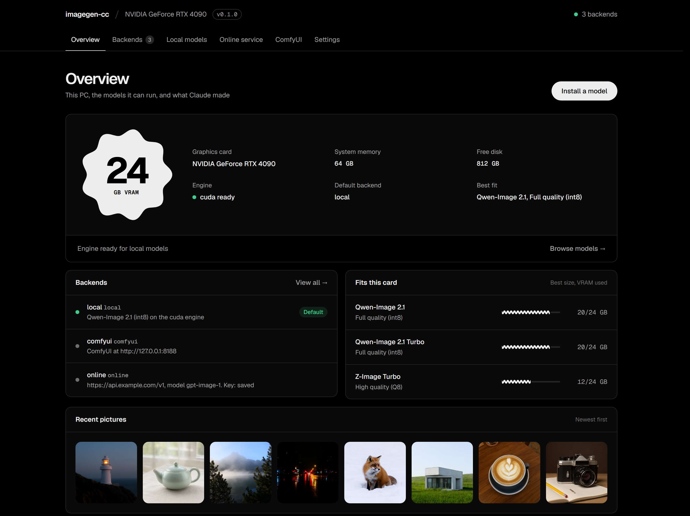
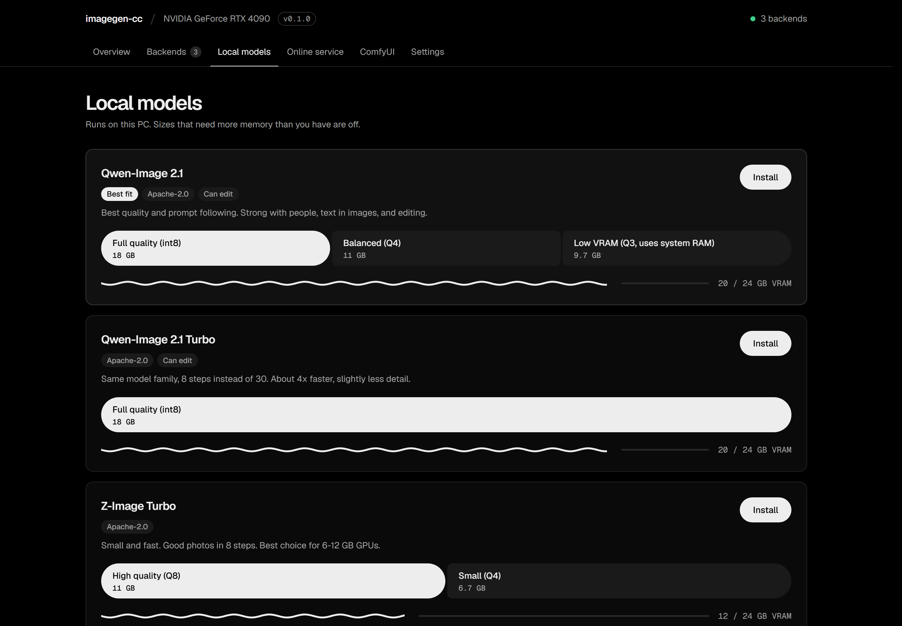
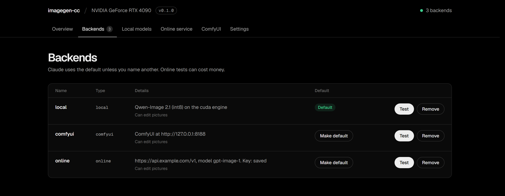
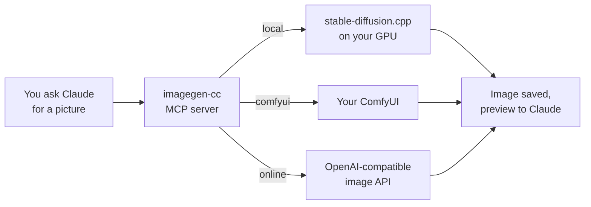

<h1 align="center">imagegen-cc</h1>

<p align="center">
  <strong>Image generation and editing for Claude Code.</strong><br>
  Run models on your own GPU, use your ComfyUI, or connect any OpenAI-compatible image API.
</p>

<p align="center">
  <a href="https://github.com/Master0fFate/imagegen-cc/actions/workflows/ci.yml"></a>
  <a href="https://github.com/Master0fFate/imagegen-cc/releases"></a>
  
  <a href="LICENSE"></a>
</p>

<p align="center">
  <a href="#quick-start">Quick start</a> ·
  <a href="#tutorial-your-first-picture">Tutorial</a> ·
  <a href="#backends">Backends</a> ·
  <a href="#local-models">Local models</a> ·
  <a href="#privacy">Privacy</a> ·
  <a href="#troubleshooting">Troubleshooting</a>
</p>

<p align="center">
  
</p>

## Why

Claude can write a landing page, but it cannot make the hero image. imagegen-cc gives it a camera. You ask for a picture in plain words; Claude writes the prompt, generates the image, looks at a preview, and saves it where your project needs it.

- **Local first.** Runs [stable-diffusion.cpp](https://github.com/leejet/stable-diffusion.cpp) on your GPU. No Python, no CUDA toolkit, no manual setup.
- **One-click models.** The setup page reads your hardware and offers only models that fit, with pinned checksums.
- **Reuses what you have.** Point it at your ComfyUI `models` folder and existing files are linked, not downloaded again.
- **Bring your own service.** Your running ComfyUI, or any OpenAI-compatible images API.
- **Edits too.** Change colors, objects or style of an existing image, or use images as references.
- **Clean uninstall.** Engine, downloaded models and saved keys go away with the plugin. Your pictures stay.

## Quick start

**1. Install the plugin**

In Claude Code:

```
/plugin marketplace add Master0fFate/imagegen-cc
/plugin install imagegen-cc@imagegen-cc
```

Or from a terminal:

```bash
claude plugin marketplace add Master0fFate/imagegen-cc
claude plugin install imagegen-cc@imagegen-cc
```

**2. Open the setup page**

```
/imagegen-cc:setup
```

**3. Ask for a picture**

```
Make a hero image of a lighthouse at dusk for the landing page and save it in public/
```

Works in the Claude Code CLI and in local sessions of the Claude desktop app (Code tab).

## Tutorial: your first picture

Setup takes a few minutes plus the model download (7 to 18 GB, depending on the model).

### 1. Open the setup page

Run `/imagegen-cc:setup` in Claude Code. A page opens in your browser. The **Overview** tab shows your graphics card, memory, free disk, and the best model for your card.

### 2. Install a local model

Open **Local models**. The model marked **Best fit** suits your card. Pick a size (larger sizes look better and need more VRAM; sizes your card cannot run are switched off) and press **Install**.

<p align="center">
  
</p>

> **Already use ComfyUI?** Before installing, enter your ComfyUI `models` folder under **Existing files**. Files with the same name and size are used where they are, so nothing downloads twice.

The install downloads the engine for your GPU, the model files, and verifies every file against a pinned SHA-256 hash. Progress shows in the corner.

### 3. Test it

Open **Backends** and press **Test**. The plugin makes one small picture and shows it. When the picture appears, Claude can use the backend.

<p align="center">
  
</p>

### 4. Ask Claude

Back in Claude Code, describe what you need. Some ideas:

| You say | Claude does |
|---|---|
| "Make a product photo of a white ceramic mug on a wooden table, save it in `assets/`" | Generates and copies the file into your project |
| "Now make the mug matte black" | Edits the previous image with it as reference |
| "Give me 4 variations of an app icon of a paper plane, 1024x1024" | Generates a batch |
| "Use comfyui for this one" | Uses a named backend instead of the default |

The first picture after a pause takes longer while the model loads. The engine then stays warm and stops after 10 idle minutes to free VRAM.

## Backends

A backend is where pictures are made. You can add several and pick a default.

| Backend | Best for | Set up in |
|---|---|---|
| **Local** | Private, free, works offline after install | Local models |
| **ComfyUI** | Your existing ComfyUI setup at its full speed | ComfyUI |
| **Online service** | No GPU, or a specific hosted model | Online service |

**ComfyUI.** Press *Load model lists*, pick the Qwen-Image 2.1 files, and save. To use your own workflow, export it with *Workflow → Export (API)* and put `{{prompt}}` where the prompt text goes. Other placeholders: `{{negative_prompt}}`, `{{seed}}`, `{{width}}`, `{{height}}`, `{{steps}}`, `{{guidance}}`, `{{count}}`, `{{image}}`.

**Online service.** Any endpoint that speaks the OpenAI images API (`/images/generations`, `/images/edits`). Enter the base address, the model name, and your key. Custom auth headers and extra request fields are under *Custom settings*.

## Local models

| Model | Sizes | Minimum VRAM | Edits | License |
|---|---|:---:|:---:|---|
| **Qwen-Image 2.1** | int8 18 GB · Q4 10.7 GB · Q3 9.7 GB | 20 · 12 · 8 GB | ✓ | Apache-2.0 |
| **Qwen-Image 2.1 Turbo** | int8 18 GB | 20 GB | ✓ | Apache-2.0 |
| **Z-Image Turbo** | Q8 11.2 GB · Q4 6.7 GB | 12 · 6 GB | | Apache-2.0 |

The engine is chosen for your hardware and falls back automatically if the first choice does not start:

| GPU | Engine |
|---|---|
| NVIDIA on Windows | CUDA → Vulkan |
| AMD | ROCm → Vulkan |
| NVIDIA or Intel on Linux, Intel on Windows | Vulkan |
| Apple Silicon | Metal |
| No supported GPU | CPU |

Local models run on Windows x64, Linux x64 and Apple Silicon Macs. On other systems (Linux arm64, Intel Macs) use ComfyUI or an online service.

## How it works



The plugin is a single native binary (Rust) that Claude Code starts as an MCP server. It exposes four tools:

| Tool | Purpose |
|---|---|
| `generate_image` | New image from a prompt |
| `edit_image` | Edit images or use them as references |
| `list_backends` | Configured backends and the output folder |
| `open_setup` | Open the setup page |

Full-size pictures are saved to `Pictures/imagegen-cc/YYYY-MM/`. Claude gets a small JPEG preview, so it can check its own work without filling its context.

## Privacy

- **Plugin data** (engine, downloaded models, settings) lives in `~/.claude/plugins/data/` and is deleted when the plugin is uninstalled.
- **API keys** are encrypted (ChaCha20-Poly1305) with a key held in the system password store: Windows Credential Manager, macOS Keychain or Secret Service. Without a password store, keys are kept in a file only your user can read. Keys never appear in Claude's conversation.
- **The setup page** listens on `127.0.0.1` only and needs a random token on every request.
- **Network.** The plugin talks only to the backends you configure, Hugging Face (model downloads), GitHub (engine downloads) and AMD's package index (ROCm runtime files for AMD GPUs).
- **Your files.** `edit_image` accepts only real image files, and the plugin never overwrites an existing file.

## Troubleshooting

<details>
<summary><b>Claude says no image backend is configured</b></summary>

Run `/imagegen-cc:setup` and install a model or connect a service, then press **Test** under Backends.
</details>

<details>
<summary><b>The first picture is slow</b></summary>

The first request after a pause loads the model into VRAM. Later requests reuse it. The engine stops after 10 idle minutes to free memory for other programs.
</details>

<details>
<summary><b>Local generation on an AMD GPU is slower than my ComfyUI</b></summary>

ComfyUI with PyTorch ROCm can be faster on some AMD cards. Connect it under **ComfyUI** and make it the default, or ask Claude to "use comfyui".
</details>

<details>
<summary><b>"Model file is missing"</b></summary>

A linked file was moved or deleted. Open the setup page, remove the backend, and install the model again.
</details>

<details>
<summary><b>Where are the logs?</b></summary>

The engine log is in the plugin data folder under `logs/engine.log`. The **Settings** tab of the setup page shows the folder.
</details>

<details>
<summary><b>How do I remove everything?</b></summary>

Open **Settings → Remove everything** in the setup page. It stops the engine, deletes downloaded models, the engine and saved keys, and uninstalls the plugin. Your own model files and your pictures are kept.
</details>

## Building from source

Requires Rust (stable) and Node.js 22.

```bash
cargo build --release
node scripts/check.mjs
node scripts/pack.mjs
node scripts/smoke.mjs --mcpb dist/release/imagegen-cc.mcpb
```

`pack.mjs` writes an installable plugin and a local marketplace to `dist/`:

```bash
claude plugin marketplace add ./dist
claude plugin install imagegen-cc@imagegen-cc-local
```

| Path | Contents |
|---|---|
| `src/` | MCP server, setup page server, engine manager, downloader |
| `web/` | Setup page (embedded into the binary) |
| `plugin/` | Plugin manifest and skills |
| `resources/catalog.json` | Models and engines with pinned sizes and SHA-256 hashes, regenerated by `scripts/catalog.mjs` |
| `scripts/` | Packaging, checks and the cross-platform smoke test |

CI builds Windows, Linux (x64 and arm64) and a universal macOS binary, then runs the smoke test on each platform.

## Credits

- [stable-diffusion.cpp](https://github.com/leejet/stable-diffusion.cpp) for local inference
- [Qwen-Image](https://huggingface.co/Qwen) and [Z-Image](https://huggingface.co/Tongyi-MAI) model families
- [Geist](https://github.com/vercel/geist-font) typeface, under the [SIL Open Font License 1.1](web/OFL.txt)

## License

[MIT](LICENSE)
